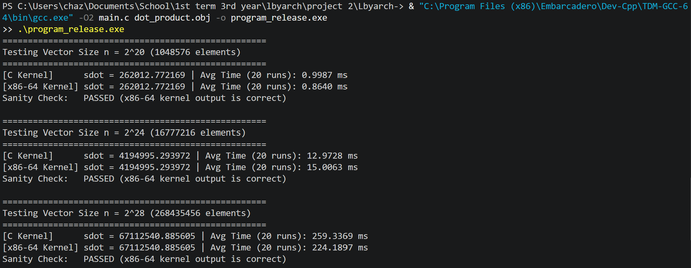

### CAINDOY, INOCENCIO | LBYARCH S30G


# Dot Product Kernel: C vs. x86-64 Assembly (Scalar SIMD)
Computes sdot = Σ A[i] * B[i] for two double-precision vectors with:

C kernel (dot_product_c), used as the sanity-check answer key
x86-64 NASM kernel (dot_product_asm), using scalar SIMD registers and scalar SIMD floating-point instructions


## 1. How to Build and Run
**Command line:**
```
nasm -f win64 dot_product.asm -o dot_product.obj
gcc -O0 -g main.c dot_product.obj -o program_debug.exe
gcc -O2    main.c dot_product.obj -o program_release.exe
.\program_debug.exe
.\program_release.exe
```

## 2. Methodology
* Vectors A and B are filled with random doubles in [0, 1] (rand() seeded with time(NULL)).
* Only the kernel call is timed. Each kernel is run 20 times per vector size and the average is reported.
* The C kernel's result is the answer key; the x86-64 result passes if its relative difference from C is ≤ 1e-5.
* Vector sizes used: n = 2^20, 2^24, and 2^28.
* We initially tried using n = 2^30 and n = 2^29, but both of them failed, so we used n = 2^28 as the fallback.

## 3. Comparative Execution Time (Average of 20 Runs)

| Vector Size ($n$) | C (Debug) | x86-64 (Debug) | C (Release) | x86-64 (Release) |
| :--- | :---: | :---: | :---: | :---: |
| $2^{20}$ (1,048,576) | `2.5065 ms` | `0.7195 ms` | `0.9987 ms` | `0.8640 ms` |
| $2^{24}$ (16,777,216) | `37.1343 ms` | `13.2075 ms` | `12.9728 ms` | `15.0063 ms` |
| $2^{28}$ (268,435,456) | `570.7993 ms` | `229.6615 ms` | `259.3369 ms` | `224.1897 ms` |

## 4. Performance Analysis
* **Debug Mode (`-O0`):** Across all vector sizes, the hand-written x86-64 assembly kernel is roughly **2.5x to 3.5x faster** than the C kernel (`0.7195 ms` vs. `2.5065 ms` at $2^{20}$, and `229.6615 ms` vs. `570.7993 ms` at $2^{28}$). In Debug mode, the compiler disables optimizations and stores loop variables and intermediate values on the stack, causing frequent memory reads and writes. In contrast, the x86-64 assembly kernel keeps the running sum (`xmm0`), pointers (`rdx`, `r8`), and loop counter (`r10`) directly inside CPU registers.
* **Release Mode (`-O2`):** Enabling compiler optimizations cuts the C kernel's execution time by more than half (`259.3369 ms` vs. `570.7993 ms` at $2^{28}$), bringing its performance on par with the scalar x86-64 assembly kernel (`224.1897 ms`). Because the `.obj` file is pre-assembled, the x86-64 kernel's runtime stays nearly constant between Debug and Release builds (~`224–229 ms` at $2^{28}$). At $2^{28}$, both kernels become primarily **memory-bandwidth bound**, as streaming two arrays of ~2.15 GB each (4.3 GB total) from system RAM limits throughput regardless of instruction scheduling.
* **Correctness Verification:** In both Debug and Release builds, the `sdot` values computed by the x86-64 scalar SIMD assembly kernel (`movsd`, `mulsd`, `addsd`) match the C reference kernel across all vector sizes (`262115.690721` at $2^{20}$, `4194151.944268` at $2^{24}$, and `67111981.284301` at $2^{28}$ in Debug; `262012.772169`, `4194995.293972`, and `67112540.885605` in Release).

## 5. Program Output & Correctness Check
The x86-64 kernel's sdot matched the C kernel's in every run (PASSED). The values differ between the Debug and Release builds only because the random data is regenerated on each program launch; the check is C vs. x86-64 within the same run.

### Debug Mode Output


### Release Mode Output


## 4. Video Demonstration
[Watch the 5–10 minute source code, compilation, and execution walkthrough](https:// )
